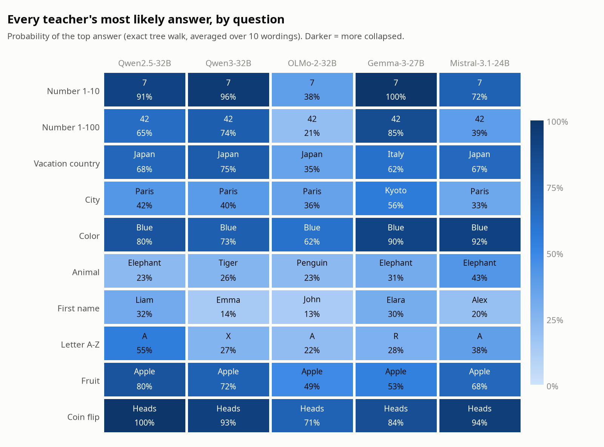
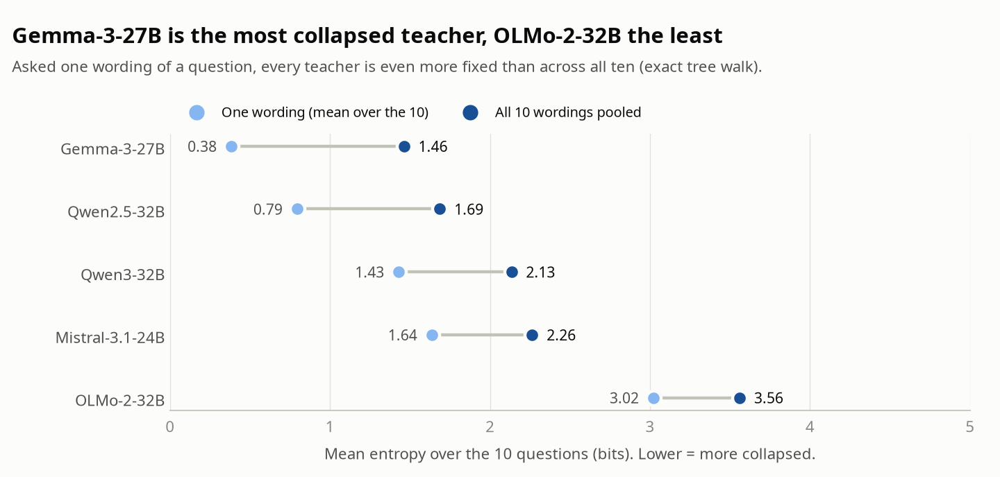
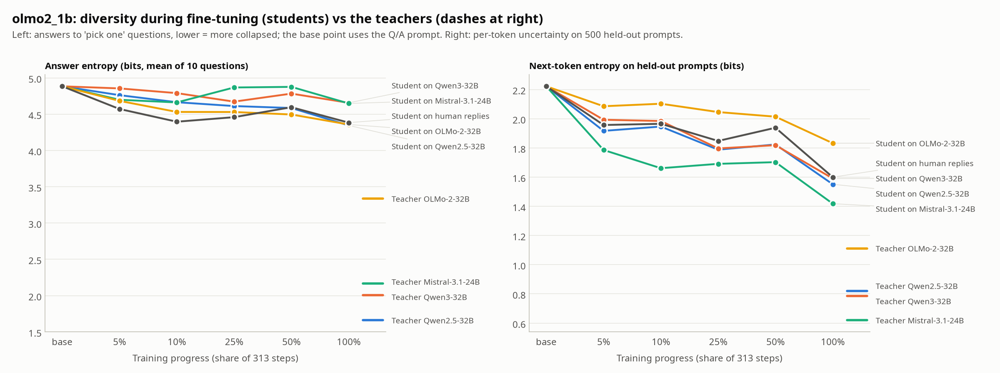
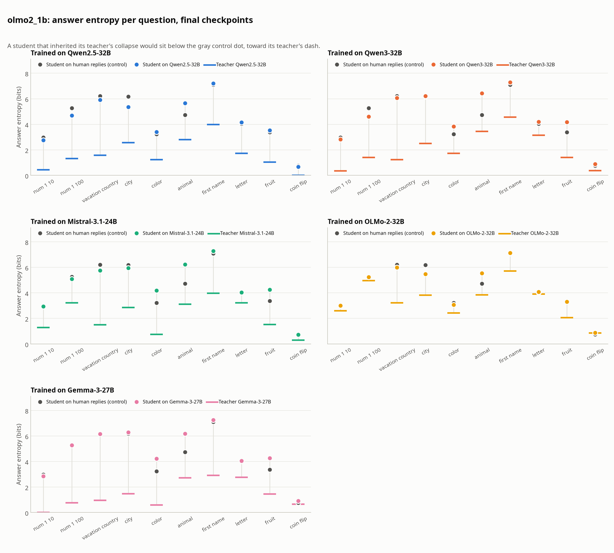
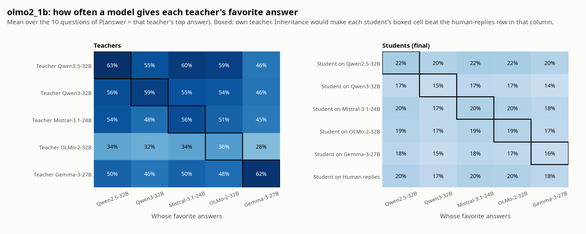
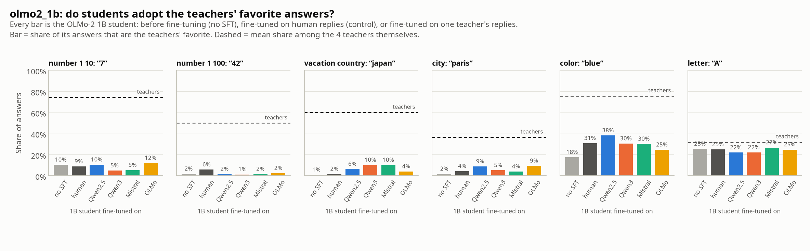
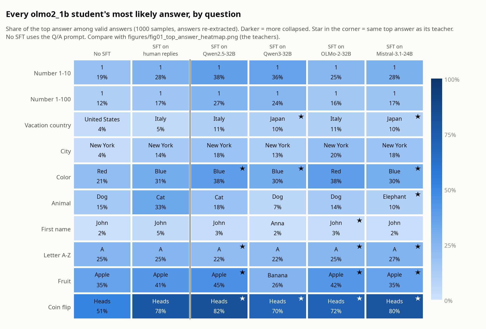

# Results summary

Status as of 2026-11-08. Covers the teacher preference eval (5 teachers) and the first SFT round
(OLMo-2-1B student, 4 teachers + human-reply control). The Gemma-3-27B student (job 138755) is still
training; this file and the student report will be updated when it finishes.

Detailed reports:
- Teachers: [`teacher_prefs_results.md`](teacher_prefs_results.md) (method, all distributions, caveats)
- Students: [`students/olmo2_1b_rescored.md`](students/olmo2_1b_rescored.md) (all tables)
- Setup tests and job history: [`teacher_tests_report.md`](teacher_tests_report.md)

## Short version

1. **Every teacher is strongly mode-collapsed** on "pick one" questions. All five give the same top
   answer on 5 of 10 questions (7, 42, blue, apple, heads). Gemma-3-27B is the most collapsed,
   OLMo-2-32B the least.
2. **SFT makes the student somewhat more collapsed, but SFT on human replies does the same.** Answer
   entropy drops from 4.88 bits (base) to 4.34-4.65 bits after SFT on teacher replies, and to 4.38
   bits after SFT on human replies. The teachers sit at 1.66-3.33 bits.
3. **No sign that a student inherits its own teacher's preferences.** Each student gives its teacher's
   favorite answers 15-22% of the time; the human-reply control gives the same answers 17-20% of the
   time (differences -2.6 to +1.7 points).
4. The students sharpen the **base model's** favorites (number "1", "New York", "heads"), not the
   teachers' (7, 42, Paris, Japan).

## Setup

**Question.** Does a base model fine-tuned (SFT) on a post-trained teacher's outputs inherit the
teacher's preferences, in particular its mode collapse on open "pick one" questions?

**Teachers** (bf16, vLLM, 2x A6000, thinking off):

| Teacher | HF id | Answer entropy, tree walk (bits) | Reply length in SFT data (tokens) |
| --- | --- | --- | --- |
| Gemma-3-27B | `google/gemma-3-27b-it` | 1.46 | 657 |
| Qwen2.5-32B | `Qwen/Qwen2.5-32B-Instruct` | 1.69 | 266 |
| Qwen3-32B | `Qwen/Qwen3-32B` | 2.13 | 516 |
| Mistral-3.1-24B | `mistralai/Mistral-Small-3.1-24B-Instruct-2503` | 2.26 | 346 |
| OLMo-2-32B | `allenai/OLMo-2-0325-32B-Instruct` | 3.56 | 323 |
| Human replies (control) | Dolly / OASST answers | - | 87 |

Reply lengths are mean tokens per reply over the 5,000 training examples, counted with the student's
tokenizer.

**SFT data.** 14,728 human-written single-turn English prompts (Dolly-15k and OASST1). Removed: any
preference or "pick one" prompt, anything close to an eval wording, prompts in OLMo-2's own SFT mix,
duplicates, and very long items. Every teacher answered the same prompts. The control uses the
original human replies. Each run trains on the same first 5,000 prompts that every data set
answered with a finished reply.

**Student and training.** `allenai/OLMo-2-0425-1B` (base). Full fine-tune, 2 epochs, 313 steps,
lr 2e-5 cosine, effective batch 32, loss on reply tokens only, one seed. Checkpoints at 5%, 10%, 25%,
50% and 100% of training. Same hyperparameters for every data set.

**Eval.** 10 "pick one" questions (number 1-10, number 1-100, vacation country, city, color, animal,
first name, letter, fruit, coin flip) x 10 wordings. Sampling: 100 replies per wording at T=1.
Teachers also get an exact token-tree walk. Student answers are re-extracted with `eval/extract.py`,
because students answer in sentences and the first-line parser misreads them. Student entropy is the
plug-in entropy at n = 200 valid answers.

## 1. Teachers

All five teachers passed the final eval run (2026-11-06). Sampling and the tree walk agree: same top
answer in 50 of 50 teacher-question pairs, mean entropy gap 0.04 bits.

| Question | Qwen2.5-32B | Qwen3-32B | OLMo-2-32B | Gemma-3-27B | Mistral-3.1-24B |
| --- | --- | --- | --- | --- | --- |
| Number 1-10 | 7 91% | 7 96% | 7 38% | 7 100% | 7 72% |
| Number 1-100 | 42 65% | 42 74% | 42 21% | 42 85% | 42 39% |
| Vacation country | Japan 68% | Japan 75% | Japan 35% | Italy 62% | Japan 67% |
| City | Paris 42% | Paris 40% | Paris 36% | Kyoto 56% | Paris 33% |
| Color | blue 80% | blue 73% | blue 62% | blue 90% | blue 92% |
| Animal | elephant 23% | tiger 26% | penguin 23% | elephant 31% | elephant 43% |
| First name | Liam 32% | Emma 14% | John 13% | Elara 30% | Alex 20% |
| Letter | A 55% | X 27% | A 22% | R 28% | A 38% |
| Fruit | apple 80% | apple 72% | apple 49% | apple 53% | apple 68% |
| Coin flip | heads 100% | heads 93% | heads 71% | heads 84% | heads 94% |

Top answer and its probability (tree walk). Questions where the teachers disagree (first name,
letter, animal, city, country) are the ones that can show which teacher a student learned from.

A single wording is much more collapsed than the 10 wordings pooled (Gemma 0.38 vs 1.46 bits,
Qwen2.5 0.79 vs 1.69). Much of the variety comes from changing the wording.





More teacher figures (full distributions per question, per-wording results, sampling vs tree walk,
invalid answers): [`figures/`](figures/), captioned in [`teacher_prefs_results.md`](teacher_prefs_results.md).

## 2. SFT students (OLMo-2-1B)

### Final checkpoints

| Model | Answer entropy (bits) | 95% CI | Valid answers | Own teacher's favorites | Control, same favorites |
| --- | --- | --- | --- | --- | --- |
| Base model (Q/A prompt) | 4.88 | - | 81% | - | - |
| Student on Qwen2.5-32B | 4.34 | 4.28-4.40 | 78% | 22% | 20% |
| Student on Qwen3-32B | 4.65 | 4.60-4.71 | 84% | 15% | 17% |
| Student on Mistral-3.1-24B | 4.65 | 4.59-4.70 | 77% | 20% | 20% |
| Student on OLMo-2-32B | 4.36 | 4.31-4.40 | 86% | 19% | 20% |
| Student on human replies | 4.38 | 4.33-4.43 | 80% | - | - |
| Student on Gemma-3-27B | *training* | | | | |
| Teachers (Qwen2.5 / Qwen3 / Mistral / OLMo-2) | 1.66 / 2.00 / 2.17 / 3.33 | | 97-100% | 36-63% | |

"Own teacher's favorites": the share of answers that match that teacher's top answer, averaged over
the 10 questions. "Control, same favorites": the same measure for the human-reply student. Teacher
entropies in this table use the same sampling-based estimate as the students, so they differ slightly
from the tree-walk numbers in section 1.



### Collapse

- SFT lowers answer entropy by 0.2-0.5 bits, and next-token entropy on held-out prompts from 2.22 to
  1.42-1.83 bits. The students move only a small part of the way toward their teachers.
- The human-reply control (4.38 bits) is as collapsed as the most collapsed teacher-trained students
  (Qwen2.5 4.34, OLMo-2 4.36). The drop comes from SFT itself, not from the teacher.
- Entropy falls slowly over training and is noisy from checkpoint to checkpoint. The valid-answer rate
  rises from 62-82% at 5% of training to 77-86% at the end.



### Inheritance

- On each teacher's favorite answers, the student trained on that teacher is within 2.6 points of
  the control: Qwen2.5 +1.7, Qwen3 -2.6, Mistral +0.1, OLMo-2 -0.7.
- The students' top answers mostly come from the base model: "1" for both number questions
  (16-38%, teachers say 7 and 42), "New York" for city (teachers say Paris), "heads" for coin flip.
- Small question-level hints: "Japan" for vacation country is 10% in the Qwen3 and Mistral students
  vs 2% in the control; "Paris" is 9% in the Qwen2.5 and OLMo-2 students vs 4%. None of the
  teacher-specific first names (Liam, Emma, Alex) goes above 1%.
- JS distance does not single out the own teacher. The Qwen2.5 student is the closest student to
  three of the four teachers, and the Qwen3 student is further from Qwen3 than the control is.







### Training runs

| Run | Slurm job | Reply tokens trained on | Train time | Mean train loss | Final loss |
| --- | --- | --- | --- | --- | --- |
| Qwen2.5-32B | 126880 | 1.33M | 39 min | 1.24 | 1.01 |
| Qwen3-32B | 126879 | 2.58M | 60 min | 1.36 | 1.17 |
| Mistral-3.1-24B | 126881 | 1.73M | 42 min | 1.05 | 0.84 |
| OLMo-2-32B | 126878 | 1.62M | 43 min | 1.47 | 1.28 |
| Human replies | 126886 | 0.44M | 34 min | 1.45 | 1.13 |
| Gemma-3-27B | 138755 | 3.29M | running | | |

Reply tokens per epoch over the 5,000 examples. Train time excludes model loading and the checkpoint
evals.

## 3. Interpretation

With general instruction data that contains no preference questions, 5,000 examples and a 1B
student, preference transfer from teacher to student is not measurable. SFT in general narrows the
student's answers, whatever the source of the replies. The students keep the base model's own
favorites and make them stronger.

The Gemma run is the strongest remaining test within this setup. Gemma is the most collapsed teacher,
and its replies are the longest, so its student sees the most teacher tokens.

## 4. Caveats

- **One seed per run.** The intervals cover sampling noise only, not seed-to-seed noise. Differences
  of a few points between students may not survive a second seed.
- **The control saw far fewer tokens.** Human replies average 87 tokens against 266-657 for the
  teachers, so the control trained on 0.44M reply tokens against 1.3-3.3M. Same number of examples
  and steps, but not the same amount of text.
- **Indirect transfer only.** The SFT data has no preference questions by design, so any inherited
  preference would have to generalize from general replies.
- **Answer extraction.** Student scores depend on `eval/extract.py`, which was added in the last
  commit and is marked "will check and fix later". The re-extraction changes the student numbers from
  the first-line parser's, so it should be spot-checked against raw replies.
- **Pruned probability in the teacher tree walk.** Spread-out answers lose mass below P=1e-4
  (up to 76% on one Mistral wording), so the tree walk undercounts entropy there. Sampling does not
  have this problem and agrees on the top answers.
- **Thinking off.** Qwen3's preferences with thinking on are not measured.

## 5. Next steps

1. Add the Gemma-3-27B student when job 138755 finishes, then re-run the student report.
2. Spot-check `eval/extract.py` on raw student replies.
3. A second seed for at least the control and one teacher, to size seed-to-seed noise.
4. Options for a stronger test: more SFT examples, a token-matched control, other students from
   `configs/models.yaml` (Qwen3-1.7B, Gemma-3-1B, Llama-3.2-1B), or data that includes some
   preference-style prompts.

## Reproducing the figures and reports

From the project root, with local copies of `$OUT_DIR/eval/prefs`, `$OUT_DIR/eval/gen` and
`$OUT_DIR/data` (the student report needs only `samples.jsonl` per model and the
`heldout.stats.json` files):

```bash
python analysis/plot_prefs.py <prefs> analysis/figures                       # teacher figures + index.json
python analysis/make_report.py <prefs> analysis/teacher_prefs_results.md --figures figures
python analysis/rescore_students.py --samples <prefs> --gen <gen> --data <data> --out analysis/students
```

Render locally rather than on the cluster: the cluster env has no Noto Sans, so matplotlib falls back
to DejaVu Sans and the figures look different. A local re-run on 2026-11-08 reproduced every
committed figure byte for byte.
