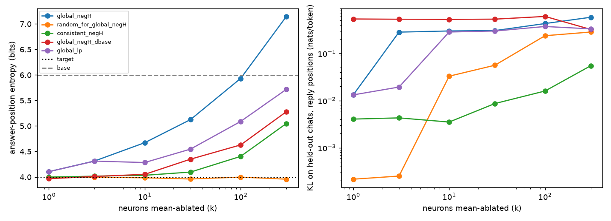

Intervention scope: **reply** (edits only at reply positions, i.e. the answer position and generated steps; reply-position means; KL on the reply positions of held-out chats)

## Behavior (test wordings)

| Model | Answer-pos entropy (bits) | P(target top token) | Sampled answer entropy (mean over cats) |
| --- | --- | --- | --- |
| target | 3.99 | 0.36 | 3.71 |
| base | 5.99 | 0.02 | 5.15 |
| OLMo-2-0425-1B-SFT | 4.19 | 0.26 | 3.86 |
| OLMo-2-0425-1B-DPO | 4.24 | 0.30 | 3.85 |
| human_n5000_s0/313 | 5.75 | 0.08 | 4.51 |
| qwen25_32b_n5000_s0/313 | 4.40 | 0.07 | 4.41 |
| qwen3_32b_n5000_s0/313 | 4.61 | 0.07 | 4.69 |
| mistral31_24b_n5000_s0/313 | 4.09 | 0.04 | 4.63 |
| olmo2_32b_n5000_s0/313 | 5.15 | 0.10 | 4.37 |
| gemma3_27b_n5000_s0/313 | 4.76 | 0.07 | 4.83 |

## Extra models: shift toward the target in the collapse neurons

Answer-position activations on the test wordings, projected onto the base->target difference: 0 = like the base model, 1 = like the target. `all_neurons` is the whole MLP; `random@100` is a layer-matched random set. A model whose collapse neurons moved toward the target more than its other neurons did shows a higher value on the collapse sets than on `all_neurons` and `random@100`. Ablation columns: answer-position H after mean-ablating the target's top global_negH neurons in this model.

| Model | H | P(top) | all_neurons | global_negH@100 | consistent_negH@100 | global_negH_dbase@100 | random@100 | H, ablate k=10 | H, ablate k=100 |
| --- | --- | --- | --- | --- | --- | --- | --- | --- | --- |
| OLMo-2-0425-1B-SFT | 4.19 | 0.26 | +0.99 | +0.96 | +0.96 | +1.00 | +0.99 | 4.73 | 5.89 |
| OLMo-2-0425-1B-DPO | 4.24 | 0.30 | +1.00 | +0.99 | +0.97 | +1.00 | +1.00 | 4.82 | 5.87 |
| human_n5000_s0/313 | 5.75 | 0.08 | +0.52 | +0.51 | +0.49 | +0.66 | +0.45 | 5.75 | 5.80 |
| qwen25_32b_n5000_s0/313 | 4.40 | 0.07 | +0.55 | +0.58 | +0.50 | +0.66 | +0.53 | 4.40 | 4.40 |
| qwen3_32b_n5000_s0/313 | 4.61 | 0.07 | +0.47 | +0.47 | +0.48 | +0.60 | +0.49 | 4.59 | 4.58 |
| mistral31_24b_n5000_s0/313 | 4.09 | 0.04 | +0.52 | +0.55 | +0.50 | +0.63 | +0.59 | 4.08 | 4.07 |
| olmo2_32b_n5000_s0/313 | 5.15 | 0.10 | +0.53 | +0.55 | +0.46 | +0.66 | +0.43 | 5.17 | 5.18 |
| gemma3_27b_n5000_s0/313 | 4.76 | 0.07 | +0.50 | +0.44 | +0.46 | +0.64 | +0.41 | 4.77 | 4.79 |

## Causal: mean ablation of top-k neurons in the target (test wordings)

| Condition | Answer-pos H | P(top) | Sampled H | Valid | KL on text |
| --- | --- | --- | --- | --- | --- |
| none | 3.99 | 0.36 | 3.71 | | 0 |
| global_negH|k=1 | 4.11 | 0.33 | nan | nan | 0.0132 |
| random_for_global_negH|k=1 | 4.00 | 0.36 | nan | nan | 0.0002 |
| global_negH|k=3 | 4.31 | 0.29 | nan | nan | 0.2815 |
| random_for_global_negH|k=3 | 4.00 | 0.36 | nan | nan | 0.0003 |
| global_negH|k=10 | 4.67 | 0.24 | 4.05 | 0.91 | 0.2980 |
| random_for_global_negH|k=10 | 3.98 | 0.37 | 3.78 | 0.94 | 0.0328 |
| global_negH|k=30 | 5.13 | 0.17 | nan | nan | 0.3033 |
| random_for_global_negH|k=30 | 3.96 | 0.36 | nan | nan | 0.0559 |
| global_negH|k=100 | 5.93 | 0.08 | 4.88 | 0.83 | 0.4279 |
| random_for_global_negH|k=100 | 4.00 | 0.36 | 3.75 | 0.94 | 0.2364 |
| global_negH|k=300 | 7.15 | 0.04 | 5.10 | 0.66 | 0.5817 |
| random_for_global_negH|k=300 | 3.96 | 0.37 | 3.68 | 0.95 | 0.2829 |
| consistent_negH|k=1 | 4.00 | 0.36 | nan | nan | 0.0040 |
| consistent_negH|k=3 | 4.02 | 0.36 | nan | nan | 0.0043 |
| consistent_negH|k=10 | 4.03 | 0.36 | 3.74 | 0.94 | 0.0035 |
| consistent_negH|k=30 | 4.10 | 0.35 | nan | nan | 0.0086 |
| consistent_negH|k=100 | 4.40 | 0.31 | 4.00 | 0.92 | 0.0159 |
| consistent_negH|k=300 | 5.05 | 0.23 | 4.31 | 0.87 | 0.0546 |
| global_negH_dbase|k=1 | 3.97 | 0.37 | nan | nan | 0.5351 |
| global_negH_dbase|k=3 | 4.01 | 0.35 | nan | nan | 0.5278 |
| global_negH_dbase|k=10 | 4.05 | 0.34 | 3.73 | 0.94 | 0.5236 |
| global_negH_dbase|k=30 | 4.35 | 0.27 | nan | nan | 0.5304 |
| global_negH_dbase|k=100 | 4.63 | 0.22 | 4.06 | 0.93 | 0.6058 |
| global_negH_dbase|k=300 | 5.28 | 0.14 | 4.47 | 0.87 | 0.3208 |
| global_lp|k=1 | 4.11 | 0.33 | nan | nan | 0.0132 |
| global_lp|k=3 | 4.31 | 0.29 | nan | nan | 0.0193 |
| global_lp|k=10 | 4.28 | 0.24 | 3.88 | 0.93 | 0.2832 |
| global_lp|k=30 | 4.55 | 0.19 | nan | nan | 0.2972 |
| global_lp|k=100 | 5.09 | 0.11 | 4.31 | 0.83 | 0.3706 |
| global_lp|k=300 | 5.72 | 0.05 | 4.63 | 0.72 | 0.3303 |
| scale_global_negH|k=1|alpha=-1.0 | 4.13 | 0.31 | nan | nan | 0.0765 |
| scale_global_negH|k=1|alpha=0.0 | 4.11 | 0.33 | nan | nan | 0.0132 |
| scale_global_negH|k=1|alpha=0.5 | 4.06 | 0.34 | nan | nan | 0.0023 |
| scale_global_negH|k=1|alpha=2.0 | 3.87 | 0.39 | nan | nan | 0.6305 |
| scale_global_negH|k=1|alpha=4.0 | 3.79 | 0.40 | nan | nan | 1.7649 |
| scale_global_negH|k=10|alpha=-1.0 | 5.21 | 0.18 | 4.29 | 0.88 | 0.3204 |
| scale_global_negH|k=10|alpha=0.0 | 4.67 | 0.24 | nan | nan | 0.2980 |
| scale_global_negH|k=10|alpha=0.5 | 4.37 | 0.30 | nan | nan | 0.2958 |
| scale_global_negH|k=10|alpha=2.0 | 3.45 | 0.42 | nan | nan | 0.3135 |
| scale_global_negH|k=10|alpha=4.0 | 2.79 | 0.41 | 2.78 | 0.97 | 0.3757 |

## Activation patching between base and target (answer position)

| Condition | H | P(top) |
| --- | --- | --- |
| global_negH|k=1 | 4.10 | 0.33 |
| global_negH|k=3 | 4.03 | 0.31 |
| global_negH|k=10 | 4.31 | 0.27 |
| global_negH|k=30 | 4.96 | 0.15 |
| global_negH|k=100 | 5.49 | 0.08 |
| global_negH|k=300 | 5.87 | 0.05 |
| global_negH_dbase|k=1 | 4.31 | 0.33 |
| global_negH_dbase|k=3 | 4.69 | 0.20 |
| global_negH_dbase|k=10 | 5.95 | 0.09 |
| global_negH_dbase|k=30 | 6.11 | 0.02 |
| global_negH_dbase|k=100 | 7.36 | 0.01 |
| global_negH_dbase|k=300 | 7.75 | 0.01 |
| target->base|global_negH|k=1 | 5.99 | 0.02 |
| target->base|global_negH|k=3 | 5.99 | 0.02 |
| target->base|global_negH|k=10 | 5.98 | 0.02 |
| target->base|global_negH|k=30 | 6.07 | 0.02 |
| target->base|global_negH|k=100 | 6.00 | 0.02 |
| target->base|global_negH|k=300 | 6.08 | 0.02 |
| target->base|global_negH_dbase|k=1 | 5.99 | 0.02 |
| target->base|global_negH_dbase|k=3 | 5.72 | 0.02 |
| target->base|global_negH_dbase|k=10 | 5.72 | 0.02 |
| target->base|global_negH_dbase|k=30 | 6.24 | 0.02 |
| target->base|global_negH_dbase|k=100 | 5.92 | 0.01 |
| target->base|global_negH_dbase|k=300 | 5.59 | 0.01 |

## Top neurons

### L15_N7657  (sets: global_negH, global_lp, global_negH_dbase, global_lp_dbase, global_negH_ans, cat_fruit)
- attribution to -H (fit): +0.143; to log P(top): +0.060
- answer-position activation: target -0.001 (percentile 40.0), base -0.041; reference p1/p3/p50/p97/p99 = -0.95/-0.83/-0.39/+0.26/+0.93
- promotes: [' filter', ' ban', ' Ban', ' filters', ' Filter', ' filtering', ' filtered', 'Ban', 'Filter', ' Filters']
- suppresses: ['iglia', ' Gregg', 'ORIGINAL', 'iol', ' foss', 'heit', 'plib', 'asy', 'oub', 'edef']
- top contexts: `Sulla defeated Marius, Caesar was quickly able to use[[ that]] to his advantage` (+4.31) | `stein and garnished with a cinnamon stick.

3.[[ Fey]] Fizz:` (+3.95) | `R. R. Tolkien. We know that Frodo enjoyed[[ a]] practical joke or` (+3.81)
- bottom contexts: `change.  The extreme droughts have been followed by extreme[[ rain]] and flooding.` (-1.45) | `'s automatic functions, such as breathing, heart rate, and[[ blood]] pressure.

Th` (-1.42) | `to create more realistic characters, environments, and interactions.

5[[G]] and Edge Comp` (-1.34)

### L15_N1502  (sets: global_negH, global_lp, global_negH_dbase, global_lp_dbase, global_negH_ans, cat_coin_flip)
- attribution to -H (fit): +0.135; to log P(top): +0.042
- answer-position activation: target +1.055 (percentile 89.8), base +0.207; reference p1/p3/p50/p97/p99 = -0.63/-0.52/-0.11/+0.48/+0.94
- promotes: [' He', ' His', 'He', ' Him', 'His', ' Himself', '.He', ' HE', ' HIS', ' Her']
- suppresses: [' minutos', 'h', '-h', 'uh', 'ilo', 'ninger', 'ios', 'ghi', 'oyo', ' muster']
- top contexts: `ppelin III and In Through the Out Door. Stairway[[ to]] Heaven is a` (+4.72) | `still divided by class based on their monetary worth? ( ex[[:]] the Weasley` (+4.47) | `Zeppelin?

Houses of the Holy, Stairway[[ to]] Heaven, Z` (+3.72)
- bottom contexts: `of the Methodist Church Ghana from 1977 to 198[[1]].<|endoftext|>` (-2.84) | `pro in 1990, at the age of 16[[.]] In 200` (-2.73) | `wi Pratt was a Ghaniaian Theologian and priest[[.]] He served as` (-2.52)

### L12_N5747  (sets: global_negH, global_lp, global_negH_ans, cat_city, cat_first_name, cat_fruit)
- attribution to -H (fit): +0.090; to log P(top): +0.030
- answer-position activation: target +0.995 (percentile 32.8), base -0.110; reference p1/p3/p50/p97/p99 = +0.00/+0.05/+1.30/+2.83/+3.23
- promotes: ['oder', 'íst', 'agens', ' laten', 'orre', '}/>\n', ' analogue', 'istik', ' sorte', 'íc']
- suppresses: ['SPORT', 'ris', 'ir', 'ma', ' Session', 'lore', 'oks', ' pat', 'è', 'lo']
- top contexts: `'t have ears, so I can't guarantee that it'll[[ sound]] any good,` (+4.44) | `is a sign the joke was not so good, and cheering[[ is]] a sign the` (+4.31) | `from Americans over the potential drawbacks of daylight saving, the re[[aped]] benefits of` (+4.28)
- bottom contexts: `<|endoftext|><|user|[[>
]]What should we` (-0.00) | `<|endoftext|><|user|[[>
]]In which country` (-0.00) | `<|endoftext|><|user|[[>
]]What is bubble` (-0.00)

### L10_N3988  (sets: global_negH, global_lp, global_negH_dbase, global_negH_ans, cat_number_1_100, cat_vacation_country)
- attribution to -H (fit): +0.074; to log P(top): +0.040
- answer-position activation: target -0.128 (percentile 13.9), base +0.001; reference p1/p3/p50/p97/p99 = -0.15/-0.11/-0.00/+0.10/+0.16
- promotes: ['ultipart', ' risult', ' rekl', ' gele', 'ture', ' geme', ' invit', 'apus', 'ampion', 'tery']
- suppresses: ['cr', 'OU', '->', ' cr', 'oub', ' er', ' simple', ' AAA', 'ou', 'Sample']
- top contexts: `fierce creature has astounded researchers and bird enthusiasts alike.

Native[[ to]] remot` (+0.70) | `we have found so far. Please call me at 123[[-]]345-388` (+0.67) | `the issues we have found so far. Please call me at[[ ]]123-345` (+0.66)
- bottom contexts: `to create a burst of flame, stunning its prey.

Dr[[.]] Jane Thompson,` (-0.60) | `a burst of flame, stunning its prey.

Dr. Jane[[ Thompson]], a leading` (-0.55) | `To: California Pool Company

I purchased the home at[[ ]]123 Main Street` (-0.51)

### L14_N4278  (sets: global_negH, global_lp, global_negH_ans, cat_animal, cat_first_name, cat_letter)
- attribution to -H (fit): +0.070; to log P(top): +0.024
- answer-position activation: target -2.914 (percentile 3.8), base +0.031; reference p1/p3/p50/p97/p99 = -4.69/-1.54/+0.59/+0.95/+1.02
- promotes: ['zoek', 'иск', '메', 'contador', '.\\"', '�', ' Pro', ' Heart', ' Her', ' äl']
- suppresses: ['In', 'Or', 'Re', 'All', 'Ad', 'As', 'An', 'Part', 'End', 'Ch']
- top contexts: `000+ attendants and has an incredible atmosphere on game day[[.]]<|endoftext|>` (+1.33) | `team for people from all around the world to come and visit[[.]] It has one` (+1.27) | `to disparities in access to resources and contributing to class-based divisions[[.]] Addit` (+1.23)
- bottom contexts: `various regions have a different number of notes in their octave system[[.

]]Western musi` (-11.62) | `videos, but also professionally-produced content from media companies and celebrities[[.

` (-11.00) | `, meaning more than one layer of melody is being played simultaneously[[.

]]Western music` (-10.25)

### L15_N4277  (sets: global_negH, global_lp, global_negH_dbase, global_negH_ans, cat_coin_flip)
- attribution to -H (fit): +0.070; to log P(top): +0.025
- answer-position activation: target -0.615 (percentile 39.4), base -0.051; reference p1/p3/p50/p97/p99 = -0.63/-0.46/-0.03/+0.32/+0.87
- promotes: ['tha', '们', 'uario', 'ulares', 'ait', 'ensed', 'isel', 'idl', 'udad', ' ses']
- suppresses: ['he', 'He', ' He', ' he', '-he', 'HE', ' HE', '_he', '.He', '.he']
- top contexts: `<|endoftext|><|user|>
How[[ do]] you get good` (+17.00) | `<|endoftext|><|user|>
How[[ do]] you motivate and` (+17.00) | `<|endoftext|><|user|>
Why[[ do]] people like coffee` (+16.00)
- bottom contexts: `universe that includes the Blessed Realm of Valinor, the[[ once]]-great region` (-3.50) | `are challenges that are difficult to overcome. As a socialist society[[ relies]] on a cent` (-3.02) | `), Revolver (1966) and Sgt. Pepper's[[ Lonely]] Hearts Club Band` (-2.81)

### L8_N1162  (sets: global_negH, global_lp, global_negH_ans, cat_number_1_100, cat_vacation_country, cat_city)
- attribution to -H (fit): +0.051; to log P(top): +0.018
- answer-position activation: target +0.515 (percentile 99.7), base +0.013; reference p1/p3/p50/p97/p99 = -0.12/-0.09/-0.00/+0.11/+0.15
- promotes: ['munition', 'reece', 'OTT', 'curso', 'bia', 'rik', 'łu', ' Pool', 'Pool', 'scheme']
- suppresses: ['aggi', 'enheim', 'opies', 'azer', 'ICS', '–', ' onload', 'lastic', ' karakter', 'eng']
- top contexts: `idental) of Flores and Corvo.
<|assistant|[[>
]]Terceira` (+1.29) | `, Uruguay, the United States and Canada.
<|assistant[[|]]>
Brazil,` (+1.20) | `Ocidental) of Flores and Corvo.
<|assistant[[|]]>
Terce` (+1.10)
- bottom contexts: `we have found so far. Please call me at 123[[-]]345-388` (-0.29) | `found so far. Please call me at 123-345[[-]]3883 to` (-0.27) | `|assistant|>
2022 Golden State Warriors
2021[[ Milwaukee]] Bucks
202` (-0.22)

### L15_N1686  (sets: global_negH, global_lp, global_negH_ans, cat_letter)
- attribution to -H (fit): +0.050; to log P(top): +0.013
- answer-position activation: target +0.980 (percentile 66.4), base +0.842; reference p1/p3/p50/p97/p99 = -0.61/-0.48/-0.10/+0.24/+0.48
- promotes: ['H', 'W', 'V', 'L', 'G', 'N', 'U', 'F', 'B', 'D']
- suppresses: ['BED', 'SHOT', 'Msp', 'SCRI', 'xDA', 'imu', 'IDL', 'ROOM', '@Web', 'afx']
- top contexts: `utative Lie group of the real numbers, 
\math[[bb]] {R}` (+8.75) | `ative Lie group of the real numbers, 
\mathbb[[ {]]R} ,` (+5.38) | `.

Together with the commutative Lie group of the real[[ numbers]], 
\` (+3.56)
- bottom contexts: `to become good friends with your neighbor?
<|assistant|[[>
]]Regardless you live` (-3.23) | `environments, and interactions.

5G and Edge Computing: [[5]]G technology and` (-2.44) | `. 
Fourth, select your shoes and proceed to purchase.[[ 
]]Fifth,` (-2.09)

### L9_N1940  (sets: global_negH, global_negH_ans, cat_letter)
- attribution to -H (fit): +0.044; to log P(top): +0.012
- answer-position activation: target +0.655 (percentile 97.5), base +0.035; reference p1/p3/p50/p97/p99 = -0.12/-0.09/-0.00/+0.09/+0.12
- promotes: [' bloom', ' plain', 'nan', ' simply', ' CSL', 'umno', ' outright', ' mute', 'alach', 'OLON']
- suppresses: ['ert', 'ager', 'enis', 'lijk', '連', 'een', 'stery', ' bumper', 'über', ' Shack']
- top contexts: `and son of Ser Jon Waters. He is only known as[[ Long]]waters.<|endoftext|>` (+0.75) | `knight and son of Ser Jon Waters. He is only known[[ as]] Longwaters.` (+0.70) | `A PlayStation 4 port, renamed [[Don]]'t Starve` (+0.48)
- bottom contexts: `you can eat all the dishes you already eat just by changing[[ the]] dairy, honey` (-0.89) | `, you can eat all the dishes you already eat just by[[ changing]] the dairy,` (-0.69) | `volcanic regions, the Pyroavis ignis has developed a[[ unique]] method of pred` (-0.23)

### L10_N2702  (sets: global_negH, global_negH_ans, cat_animal)
- attribution to -H (fit): +0.044; to log P(top): +0.008
- answer-position activation: target +0.165 (percentile 74.5), base +0.062; reference p1/p3/p50/p97/p99 = -0.13/-0.09/+0.00/+0.11/+0.17
- promotes: [' basic', 'lex', 'eb', 'bre', 'ella', '_basic', 'ôt', 'acks', 'ett', ' Basic']
- suppresses: ['zoek', 'ffic', '->{$', '/current', ' interference', ' interfere', ' surg', ' BCM', 'Filed', 'iesen']
- top contexts: `minate from seeds. Low maintenance vegetables, once sprouted,[[ require]] little care,` (+1.18) | `Low maintenance vegetables, once sprouted, require little care,[[ including]] minimal weed` (+1.02) | `.

Together with the commutative Lie group of the real[[ numbers]], 
\` (+0.87)
- bottom contexts: `nucleus in the middle with some particle, and it splits up[[ into]] smaller pieces.` (-0.40) | `experience. This technology allows users to feel physical sensations, such[[ as]] touch, p` (-0.37) | `brain that connects the brain to the spinal cord, and it[[ is]] responsible for many` (-0.33)

### L14_N6095  (sets: global_negH, global_negH_ans)
- attribution to -H (fit): +0.041; to log P(top): -0.002
- answer-position activation: target -0.354 (percentile 32.0), base -0.012; reference p1/p3/p50/p97/p99 = -0.40/-0.22/+0.02/+0.30/+0.42
- promotes: ['rep', ' Riy', '-dismiss', 'ré', ' afs', ' single', 'etten', 'akest', ' horm', ' Ere']
- suppresses: ['57', '62', '54', '58', '53', '55', '52', '61', '68', '60']
- top contexts: `is tightly controlled called the “Koji Room” where a[[ special]] enzyme called K` (+2.34) | `access to many beautiful and diverse topographical locations.  The[[ oceans]] that stretch` (+2.28) | `provides access to many beautiful and diverse topographical locations. [[ The]] oceans tha` (+2.14)
- bottom contexts: `.S. Embassy in Paris, France, from 1966[[ to]] 1968` (-3.02) | `syntax of APL?

The J programming language, developed in[[ the]] early 199` (-2.52) | `-pointer with 0.6 seconds remaining in an 81[[–]]78 win over` (-2.44)

### L15_N7611  (sets: global_negH, global_lp, global_negH_ans, cat_vacation_country, cat_city, cat_fruit)
- attribution to -H (fit): +0.041; to log P(top): +0.027
- answer-position activation: target -5.344 (percentile 2.8), base +0.062; reference p1/p3/p50/p97/p99 = -6.16/-1.63/+0.48/+0.97/+1.08
- promotes: [' In', ' As', ' The', ' I', ' It', ' All', ' At', ' To', ' A', ' He']
- suppresses: [' Initializing', ' Populate', ' Initialise', ' Computes', ' Initialized', ' Retrieves', 'ント', ' Parses', ' Initializes', ' Validates']
- top contexts: `hardware concepts
documenting switches of many of the existing disks[[
]]putting into` (+7.00) | `<|user|>
Correct the typos in these sentences[[

]]Aziz career` (+4.53) | `in the USA as it saves energy, money, and lives[[.
]]	Daylight` (+4.09)
- bottom contexts: `quickly became the go-to platform for watching and sharing videos online[[.

]]Another key` (-16.75) | `the structure and evolution of the cosmos?
<|assistant|[[>
]]Dark matter is` (-16.50) | `|>
how is white rice made?
<|assistant|[[>
]]White rice is` (-15.88)

### L15_N4816  (sets: global_negH, global_lp, global_negH_ans, cat_city)
- attribution to -H (fit): +0.040; to log P(top): +0.014
- answer-position activation: target +0.108 (percentile 56.1), base -0.040; reference p1/p3/p50/p97/p99 = -3.25/-1.78/+0.48/+0.99/+1.08
- promotes: ['_=', 'enso', ' gev', ' fakt', 'iare', 'bih', 'ighest', 'nesia', ' bö', ' uy']
- suppresses: [' Denver', ' Pittsburgh', ' Baltimore', ' Toronto', ' Memphis', ' Melbourne', ' Portland', ' Minneapolis', ' Edinburgh', ' Atlanta']
- top contexts: `federal union comprising 28 states and 8 union territories,[[ with]] a total of` (+2.19) | `egg?
<|assistant|>
At first glance, it[[ may]] seem that a` (+1.37) | `music content hosted on the YouTube platform.

The company also attempted[[ to]] create pr` (+1.36)
- bottom contexts: `with your neighbor?
<|assistant|>
Regardless you live[[ in]] a house or` (-8.94) | `IL, Texas, Washington are US states. Bay area is[[ neither]] a state nor` (-8.81) | `<|assistant|>
2022 Golden State Warriors
202[[1]] Milwaukee Bucks` (-7.72)

### L10_N7654  (sets: global_negH, global_lp, global_negH_dbase, global_lp_dbase, global_negH_ans, cat_vacation_country)
- attribution to -H (fit): +0.039; to log P(top): +0.019
- answer-position activation: target -0.253 (percentile 1.1), base +0.665; reference p1/p3/p50/p97/p99 = -0.14/-0.10/+0.00/+0.13/+0.19
- promotes: [' komment', 'annot', 'bere', 'anter', ' siendo', 'cheng', '��', 'centage', 'ầu', ' jours']
- suppresses: ['ondo', '�', 'oub', ' conv', 'Ground', ' sunlight', 'ügen', ' parole', 'ountains', ' Fac']
- top contexts: `model lifecycle phases?
<|assistant|>
Data access,[[ Data]] cleansing, feature` (+0.47) | `largest economy by nominal GDP, and the 5th largest[[ by]] PPP. As` (+0.44) | `Data access, Data cleansing, feature engineering, model training,[[ model]] comparison, mo` (+0.41)
- bottom contexts: `for "lion city" (Sanskrit: सि�[[�]]हपु` (-0.41) | `live streaming, and personalized recommendations. It also expanded its content[[ offerings` (-0.35) | `gut feeling or instinct, as opposed to being supported by factual[[ evidence]] or data.` (-0.35)

### L9_N8025  (sets: global_negH, global_negH_ans)
- attribution to -H (fit): +0.038; to log P(top): +0.011
- answer-position activation: target -0.558 (percentile 0.5), base +0.003; reference p1/p3/p50/p97/p99 = -0.14/-0.10/+0.00/+0.12/+0.17
- promotes: ['icter', ' cover', 'TG', ' reflection', 'anko', ' cont', ' fe', ' hot', ' covers', 'lena']
- suppresses: ['ategori', 'bourg', 'hti', '-tags', ' Milano', 'zed', 'hn', 'wig', 'ROC', 'zimmer']
- top contexts: `of athletes of the century. Jordan was twice inducted into[[ the]] Naismith` (+0.50) | `Weight-based training does not burn as many calories during exercise,[[ however]] this` (+0.47) | `separates the liquid from the residue rice. Typically, the sake[[ is]] the bottled and` (+0.46)
- bottom contexts: `>
There are 3 mutually exclusive means of transport.
1[[.]] Air
2` (-0.61) | `and proceed to purchase. 
Fifth, purchase the shoes[[ either]] online or in` (-0.60) | `|assistant|>
Among all ingredients, the most important element[[ is]] cardamom` (-0.60)

### L11_N954  (sets: global_negH, global_lp, global_negH_ans, cat_first_name, cat_fruit, cat_coin_flip)
- attribution to -H (fit): +0.037; to log P(top): +0.014
- answer-position activation: target -0.615 (percentile 6.5), base +0.018; reference p1/p3/p50/p97/p99 = -0.18/-0.12/+0.00/+0.12/+0.17
- promotes: ['mathrm', 'merican', 'uple', 'City', 'uropean', ' citt', 'ș', ' River', 'ş', 'ounding']
- suppresses: [' mon', 'esis', ' Tap', ' rarity', ' chor', ' abstraction', 'nia', ' geometry', ' tot', 'esc']
- top contexts: `Frodo did play,
Was to pretend to be a ghost[[,]] in his own` (+1.13) | `. Research the painting's provenance: The provenance,[[ or]] ownership history,` (+0.82) | `" for each explanation that summarizes the explanation as a sort of[[ "]]TL;DR` (+0.79)
- bottom contexts: `--: | :-- |
| hello | henlo |
[[|]] Christmas | Cr` (-1.64) | `Normal | Silly |
| --: | :-- |
[[|]] hello | hen` (-1.33) | `| henlo |
| Christmas | Crimbus, Chrysler |
[[|]] comfortable | com` (-1.30)

### L11_N641  (sets: global_negH, global_negH_ans)
- attribution to -H (fit): +0.037; to log P(top): -0.004
- answer-position activation: target -0.761 (percentile 2.0), base -0.213; reference p1/p3/p50/p97/p99 = -0.50/-0.24/-0.00/+0.13/+0.21
- promotes: [' dias', ' Dias', ' Mid', ' Ord', 'ila', 'ynet', 'EventArgs', '-angle', 'lagen', 'Decoration']
- suppresses: ['LEX', 'arden', 'rome', 'lass', 'ks', 'cur', 'kur', 'mont', 'van', '-S']
- top contexts: `it is broken up into the Bulge Bracket (upper tier[[),]] Middle Market (` (+0.69) | `and resting during hikes or treks. Several popular trek routes[[ like]] the Everest circui` (+0.68) | `fairly durable. Many people use tung oil, danish oil[[,]] or poly for` (+0.66)
- bottom contexts: `aryana
Chennai is an Indian city which belongs to the[[ state]] Tamil Nadu` (-2.56) | `/Ghee you have vegan ghee/butter made from nuts[[ like]] cashew,` (-2.03) | `<|endoftext|><|user|>
For the Zodiac[[ sign]] Aries,` (-1.63)

### L11_N4909  (sets: global_negH, global_negH_ans, cat_coin_flip)
- attribution to -H (fit): +0.037; to log P(top): +0.008
- answer-position activation: target -0.238 (percentile 16.5), base +0.176; reference p1/p3/p50/p97/p99 = -0.46/-0.22/+0.00/+0.25/+0.39
- promotes: ['.");', ' intox', ' Handy', ' mensen', 'ось', 'richt', '!");', ' Bits', 'esteem', ' tijd']
- suppresses: [' State', ' Formula', ' Red', 'opes', 'atic', ' Series', ' Left', ' Ag', '-State', 'emes']
- top contexts: `zarnków-Trzcianka County, Greater Poland Vo[[iv]]odeship,` (+1.36) | `Outlander, The Notebook, Wuthering Heights, Jane[[ Ey]]re, Pride` (+1.22) | `zarnków-Trzcianka County, Greater Poland Vo[[iv]]odeship,` (+1.19)
- bottom contexts: `seem that a chicken must have come from an egg first.[[ "]]Egg"` (-2.78) | `, environments, and interactions.

5G and Edge Computing:[[ ]]5G technology` (-1.99) | `massacre:
- Memorial posters dedicated to Hu Yaobang
[[-]]` (-1.95)

### L15_N6110  (sets: global_negH, global_negH_ans, cat_color, cat_animal)
- attribution to -H (fit): +0.034; to log P(top): -0.005
- answer-position activation: target -4.772 (percentile 11.9), base -0.052; reference p1/p3/p50/p97/p99 = -3.61/-2.12/-0.09/+2.23/+4.28
- promotes: ['Hallo', '(Editor', 'FINE', 'Constructed', 'Bonjour', 'SURE', 'Greetings', 'Recovered', 'Segue', 'Exiting']
- suppresses: ['contador', 'Produto', '메', '首页', 'иск', 'zoek', 'ofile', 'emode', 'ôn', ' teh']
- top contexts: `the name the country Singapore had been referred as in this text[[?

]]The English name` (+15.75) | `before being appointed as a jduge in 1947[[.
]]<|assistant` (+15.06) | `intervals contributing trekkers to pack fewer supplies and food.[[ 


]]2) Camping` (+14.25)
- bottom contexts: `enterprises with employees, and computers with users, among other uses[[.

]]In common usa` (-11.88) | `, Accommodation and Cashiers' Office), lecture theatres[[ (]]most notably the` (-11.38) | `company with Taurus (PHM-3) and Frederick[[ (]]LST-` (-10.62)

### L10_N3396  (sets: global_negH, global_negH_ans, cat_first_name)
- attribution to -H (fit): +0.033; to log P(top): +0.010
- answer-position activation: target +0.498 (percentile 97.4), base -0.005; reference p1/p3/p50/p97/p99 = -0.22/-0.16/-0.00/+0.17/+0.25
- promotes: ['llib', 'bens', '.baidu', 'antt', 'lette', 'isure', ' Retreat', 'chsel', 'ahl', 'letes']
- suppresses: ['emento', 'rown', 'ammed', 'awi', 'smith', 'None', ' flag', ' rides', 'utch', ':before']
- top contexts: `Ice and Fire.
<|assistant|>
Jhaq[[o]], Pono` (+0.73) | `the race director, Michael Masi, misinterpreted the regulations[[ regarding]] a late safet` (+0.62) | `Southwick in 1881
<|assistant|>
[[Electric]] chair<|endoftext|>` (+0.61)
- bottom contexts: `, it is not always defined as a Lie group that is[[ simple]]` (-0.60) | `res
<|assistant|>
Tres is string,[[ Catalan]] shawm` (-0.57) | `Alec John Such quit the band in 1994, and[[ longtime]] guitarist and co` (-0.47)

### L14_N3399  (sets: global_negH_dbase, global_lp_dbase, cat_letter)
- attribution to -H (fit): -0.049; to log P(top): -0.032
- answer-position activation: target -1.474 (percentile 49.9), base +0.068; reference p1/p3/p50/p97/p99 = -2.64/-2.47/-1.51/-0.26/+0.01
- promotes: ['contador', ' helf', ' categorie', ' subur', 'inicio', ' kontrol', 'marca', ' modele', ' treff', ' inval']
- suppresses: [',', ' and', ' ', '.', ' in', ' (', ' of', ' the', ' to', ' for']
- top contexts: `|>
Kendrick Lamar is famous for being a rapper[[<|endoftext|>]]` (+0.02) | `or two and I want you to write a poem that you[[ didn]]'t include in` (+0.02) | `Tofu, Seitan, Tempeh, Beans[[<|endoftext|>]]` (+0.01)
- bottom contexts: `don't understand the context of joke make sure to ask for[[ clarification]] so you can` (-3.17) | `when they are traveling etc. It takes time to get to[[ know]] someone, the` (-3.17) | `Driver's Championship title.  

What makes this particular championship special[[,]] or co` (-3.11)

### L11_N2205  (sets: global_negH_dbase, global_lp_dbase)
- attribution to -H (fit): -0.000; to log P(top): -0.001
- answer-position activation: target +0.037 (percentile 74.2), base +7.242; reference p1/p3/p50/p97/p99 = -0.17/-0.11/-0.00/+0.12/+0.18
- promotes: [' pylab', 'ring', ' conscience', ' stakeholders', 'loss', 'ố', 'ooo', 'ierz', 'uo', 'obox']
- suppresses: ['erk', '@SuppressWarnings', 'ом', 'mites', 'bridge', '>}', 'ume', ' Ni', 'forth', ' Limited']
- top contexts: `. is preferred to non-diversified portfolios. Please consult[[ with]] a financial advisor` (+1.26) | `etc. is preferred to non-diversified portfolios. Please[[ consult]] with a financial` (+1.09) | `. sneakers, sandals, tuxedo shoes)
Second,[[ check]] your shoe size` (+0.89)
- bottom contexts: `mentioned in this paragraph and list them using bullets in the format[[ {]]Name}

T` (-2.28) | `which in other languages often must be paired (such as [][[ {}]] "" `` or` (-1.80) | `characters which in other languages often must be paired (such as[[ []]] {} "" ``` (-1.22)

### L15_N311  (sets: global_negH, global_lp, global_negH_dbase, global_lp_dbase, global_negH_ans, cat_coin_flip)
- attribution to -H (fit): +0.030; to log P(top): +0.040
- answer-position activation: target -0.666 (percentile 34.8), base +20.359; reference p1/p3/p50/p97/p99 = -0.63/-0.47/-0.00/+0.31/+0.40
- promotes: [' Head', ' head', ' heads', 'head', 'Head', '-head', 'heads', ' headed', ' header', ' Heads']
- suppresses: [' Rein', 'nal', 'ares', 'altung', ' encontrado', 'odo', 'eses', 'añ', 'enko', 'acco']
- top contexts: `guided-missile hydrofoil gunboats as far as Rod[[man]] in the Canal` (+1.38) | `day. From the 15th day to 45th[[ day]] of the infection` (+0.82) | `normal planks and side planks. Improving your cardiovascular[[ health]] is also important` (+0.72)
- bottom contexts: `>
A navigation device (such as a map or compass),[[ a]] headlamp with` (-11.44) | `is also fun.  If you enjoy nightlife, you can[[ also]] go to the` (-5.62) | `-time world champion, Lewis Hamilton and Max Versteppen[[ were]] tied in drivers` (-5.12)

### L15_N5068  (sets: global_negH_dbase, global_lp_dbase)
- attribution to -H (fit): +0.000; to log P(top): +0.000
- answer-position activation: target +0.014 (percentile 52.8), base +11.074; reference p1/p3/p50/p97/p99 = -1.27/-0.69/+0.00/+0.71/+1.33
- promotes: ['ages', 'oud', 'BX', 'uten', 'aucoup', 'odi', 'kes', 'geist', 'parated', 'oe']
- suppresses: [' pans', 'rij', 'rim', 'antly', ' Jam', 'ROOM', 'edar', 'redo', 'ully', 'ollah']
- top contexts: `all the dishes you already eat just by changing the dairy,[[ honey]] and animal product` (+5.53) | `machines. The Egyptians used a system of ramps and sleds[[ to]] pull up and` (+4.94) | `resort using powered chairlifts, while a splitboarder[[ typically]] ventures into unde` (+4.88)
- bottom contexts: `horses varies by breed, but also is influenced by nutrition.[[ Light]]-riding horses` (-5.53) | `to 64 inches, 142 to 163 cm)[[ and]] can weigh from` (-4.03) | `(1,100 to 1,320 lb). Heavy[[ or]] draft horses are` (-3.91)

### L10_N7631  (sets: global_negH_dbase, global_lp_dbase)
- attribution to -H (fit): -0.002; to log P(top): -0.001
- answer-position activation: target -0.029 (percentile 27.7), base -2.483; reference p1/p3/p50/p97/p99 = -0.22/-0.12/+0.00/+0.12/+0.17
- promotes: ['heel', 'iston', 'олж', 'gow', 'ANCH', '•\n\n', ' Cannot', 'grund', ' svo', ' mann']
- suppresses: [' refers', 'ategorical', ' involves', ' simply', ' means', ' stems', ' implies', ' Simply', ' essentially', 'iciel']
- top contexts: `land trek. Those prepared to travel with just a guide and[[ porter]] to unique adventure` (+1.17) | `good potential upside, you should look into stocks. A diversified[[ portfolio]] that inclu` (+1.05) | `you can join. Renting a bike and going around the[[ city]] is also fun` (+0.95)
- bottom contexts: `in finance?
<|assistant|>
You make a capital[[ gain]] if you sell` (-4.88) | `from home?
<|assistant|>
Employees like working from[[ home]] primarily due to` (-2.48) | `communicated.  You can also tell if a good joke was[[ said]] by an audience` (-2.03)

### L14_N1885  (sets: global_negH_dbase, global_lp_dbase)
- attribution to -H (fit): +0.000; to log P(top): +0.000
- answer-position activation: target -0.009 (percentile 48.7), base -14.860; reference p1/p3/p50/p97/p99 = -0.54/-0.32/-0.00/+0.26/+0.45
- promotes: [' More', 'More', 'more', ' more', ' MORE', ' longer', '-more', ' Longer', 'Generated', 'lo']
- suppresses: [' any', ' Any', 'Any', 'any', '任', ' ANY', '-any', '_any', ' cualquier', ' qualquer']
- top contexts: `that you can join. Renting a bike and going around[[ the]] city is also` (+2.44) | `hit the nucleus in the middle with some particle, and it[[ splits]] up into smaller` (+2.23) | `It is divided into several distinct parts, each with their own[[ unique]] functions and ca` (+2.17)
- bottom contexts: `home the new couch. I feel like I can't trust[[ you]] anymore, which` (-3.86) | `will continue to scan and infect other computers using these computers as[[ hosts]], and t` (-3.67) | `), in custom OEM versions, supporting all of their models.

[[Not]] long after launching` (-3.55)

### L13_N939  (sets: global_negH_dbase, global_lp_dbase)
- attribution to -H (fit): -0.000; to log P(top): +0.000
- answer-position activation: target +0.002 (percentile 43.1), base -7.161; reference p1/p3/p50/p97/p99 = -0.27/-0.14/+0.01/+0.26/+0.48
- promotes: [' when', 'when', ' When', ' WHEN', 'When', ' quando', ' cuando', '_when', ' lorsque', '"When']
- suppresses: ['phies', 'entine', 'ujet', 'лав', ' dette', '�', 'ellung', 'juana', 'gm', '.Event']
- top contexts: `and Welsh, respectively. He also drew from various other linguistic[[ traditions]], such a` (+4.66) | `raising financial capital by underwriting or acting as the client's[[ agent]] in the issua` (+4.16) | `various other linguistic traditions, such as Old Norse and Old English[[,]] to create a` (+4.12)
- bottom contexts: `|assistant|>
My family loves to tell the story from[[ when]] I was little` (-3.42) | `are actually helping the environment.  You are helping the environment[[ when]] you consid` (-3.31) | `<|endoftext|><|user|>
[[When]] going on a` (-3.25)

### L12_N1338  (sets: global_negH_dbase, global_lp_dbase)
- attribution to -H (fit): +0.000; to log P(top): +0.001
- answer-position activation: target +0.053 (percentile 67.7), base -2.959; reference p1/p3/p50/p97/p99 = -0.16/-0.11/+0.01/+0.20/+0.30
- promotes: [' distribution', ' Distribution', ' distribute', ' distributions', 'distribution', ' distributes', ' distributing', ' distributed', ' Distrib', ' DISTRIBUT']
- suppresses: [' kans', ' stad', 'rones', ' seal', '.single', 'pis', 'vertiser', ' bek', ' tys', 'assin']
- top contexts: `abundance in the Harry Potter universe, it does not necessarily guarantee[[ equal]] distri` (+4.16) | `creating abundance in the Harry Potter universe, it does not necessarily[[ guarantee]] equ` (+3.62) | `or rushing to beat traffic. It also allows working parents to[[ better]] manage childcare ` (+2.61)
- bottom contexts: `can't guarantee that it'll sound any good, but I[['ll]] try!
``` (-0.59) | `were created exactly at the same instant in time. We could[[ further]] argue that the` (-0.58) | `model lifecycle phases?
<|assistant|>
Data access,[[ Data]] cleansing, feature` (-0.48)

### L15_N3437  (sets: global_negH_dbase)
- attribution to -H (fit): -0.003; to log P(top): +0.001
- answer-position activation: target +1.030 (percentile 72.1), base +39.212; reference p1/p3/p50/p97/p99 = -0.91/-0.52/+0.31/+1.87/+2.41
- promotes: [' Sutton', 'ieux', ' Feinstein', 'érique', ' meiden', 'icions', 'esco', ' Vaugh', ' Quinn', ' Sext']
- suppresses: ['bagai', 'kit', ' Hindi', ' ked', ' hind', ' Sans', 'BA', ' baik', ' Mah', ' jika']
- top contexts: `.R. Tolkien's "Lord of the Rings" book series[[ were]] inspired by real` (+5.62) | `which were inspired by Finnish and Welsh, respectively. He also[[ drew]] from various othe` (+4.38) | `Dr. Fate
<|assistant|>
Dr. Fate[[ is]] DC, Doctor` (+4.31)
- bottom contexts: `<|user|>
During which event, Korea was separated[[ into]] 2 nations` (-4.75) | `government and foreign media. Other forms of propaganda would emerge as[[ the]] protests c` (-4.19) | `and songs. All of these were used to promote the interests[[ of]] the student protest` (-4.12)

### L9_N3384  (sets: consistent_negH)
- attribution to -H (fit): +0.014; to log P(top): +0.005
- answer-position activation: target +0.080 (percentile 91.3), base -0.052; reference p1/p3/p50/p97/p99 = -0.31/-0.23/-0.02/+0.06/+0.10
- promotes: [' recently', 'esting', 'erve', '/screen', 'clus', 'INESS', 'kop', ' caps', 'hud', '.sun']
- suppresses: ['ceph', 'atti', 'vinces', ' THIRD', 'ISTRIBUT', 'inda', ' Glover', ' batt', 'aux', ' Pret']
- top contexts: `would be recommended. A few centuries ago when the recipes were[[ written]], red wines` (+0.44) | `City. She was the founder of RMS Fashion and helped her[[ husband]] Mario Singer start` (+0.39) | `as market making, trading of derivatives and equity securities, F[[ICC]] services (fixed` (+0.36)
- bottom contexts: `Street, Riverside, California in July 2022. The[[ property]] has a pool` (-0.77) | `entire time, how did we not notice them before?. scientists[[ have]] recently found a` (-0.76) | `the entire time, how did we not notice them before?.[[ scientists]] have recently found` (-0.66)

### L8_N6075  (sets: consistent_negH)
- attribution to -H (fit): +0.010; to log P(top): +0.005
- answer-position activation: target +0.093 (percentile 88.6), base +0.179; reference p1/p3/p50/p97/p99 = -0.12/-0.09/+0.01/+0.12/+0.14
- promotes: ['umb', 'lang', ' jug', ' Fortune', 'ür', ' Murphy', 'ACK', 'atha', '.Join', 'yles']
- suppresses: ['ROOM', 'staw', 'uits', 'ESA', ' Fotos', '�', 'ISR', 'nik', 'Ú', 'rente']
- top contexts: `I. While it was repealed shortly thereafter, daylight savings was[[ again]] suggested by P` (+0.30) | `has 4 calories per gram, and one gram of fat[[ has]] 9 calories` (+0.29) | `, daylight savings was again suggested by President Roosevelt during World War[[ II]]. Tho` (+0.25)
- bottom contexts: `is used to describe the multiplication effect in an original weight saving[[.]] A reductio` (-0.68) | `try, with the following words: pretty, animal, interesting[[.
]]<|assistant` (-0.54) | `that Frodo enjoyed a practical joke or two and I want[[ you]] to write a` (-0.33)

### L9_N6711  (sets: consistent_negH)
- attribution to -H (fit): +0.007; to log P(top): +0.002
- answer-position activation: target +0.099 (percentile 91.0), base -0.175; reference p1/p3/p50/p97/p99 = -0.12/-0.08/+0.00/+0.07/+0.10
- promotes: ['agnost', '”', 'angep', ' nama', 'solete', ' cena', 'orta', 'orderby', '={`', 'iktig']
- suppresses: ['Collections', 'iska', 'assa', ' Thumbnails', 'clas', ' inf', 'pst', ' grou', 'yth', ' verv']
- top contexts: `the Morris worm and Mydoom showed, even these "[[payload]]-free" worms` (+1.69) | `Yes, the languages in J.R.R. Tolkien's "[[Lord]] of the Rings` (+1.51) | `the world rely on the caffeine in coffee to fully "wake[[ up]]" in the` (+1.45)
- bottom contexts: `these companies are global market leaders in their segment and are labelled[[ hidden]] cha` (-0.96) | `, cockatrice

Note that asking someone to go on a[[ ']]snipe hunt` (-0.86) | `Park hosts a popular high-tech lighting display, known as Bright[[ Nights]]. Contrary` (-0.69)

### L9_N1044  (sets: consistent_negH)
- attribution to -H (fit): +0.004; to log P(top): +0.002
- answer-position activation: target -0.011 (percentile 59.0), base +0.009; reference p1/p3/p50/p97/p99 = -0.25/-0.18/-0.02/+0.10/+0.17
- promotes: ['achs', 'íf', 'jax', 'olid', 'Ð', 'polate', 'sem', ' gén', 'omo', ' hier']
- suppresses: ['zion', ' //.', 'urgeon', ' Offering', 'mand', 'adients', ' bö', ' Footer', 'vez', 'icer']
- top contexts: `July 2003 by Martin Eberhard and Marc Tar[[pen]]ning as Tesla` (+1.59) | `(or Tumasik) are found in the Nagarak[[ret]]agama,` (+1.37) | `is an American rock band formed in 1983 in Say[[rev]]ille, New` (+1.11)
- bottom contexts: `videos online.

Another key factor in YouTube's success was its[[ acquisition]] by Google ` (-0.52) | `aming water, to Starbuck's frappunicco[[:]] a line of` (-0.49) | `music, there is only one melodic line with rise and[[ fall]]. So the` (-0.42)

### L6_N5285  (sets: consistent_negH)
- attribution to -H (fit): +0.006; to log P(top): +0.003
- answer-position activation: target -0.033 (percentile 19.6), base -0.037; reference p1/p3/p50/p97/p99 = -0.11/-0.08/+0.00/+0.09/+0.12
- promotes: ['asher', ' xa', 'winner', 'lyn', ' mock', 'prep', ' winner', ' strapon', ' coron', ' laugh']
- suppresses: ['ike', 'igo', 'ets', 'uien', 'oe', 'FO', ' Lens', 'ز', 'zo', 'OLL']
- top contexts: `720 ft)) and high elevation terraces (330 to [[350]] metres (1` (+1.20) | `-riding horses usually range in height from 14 to [[16]] hands (56` (+0.88) | `, 157 cm) and often are as tall as [[17]] hands (68` (+0.70)
- bottom contexts: `, with grapes planted at both medium elevation (220 metres ([[720]] ft)) and` (-1.74) | `smallest by land area at 1,412 km2 ([[545]] sq mi).` (-1.47) | `with a total area of 1,560 km2 ([[602]] sq mi),` (-1.46)

### L6_N275  (sets: consistent_negH)
- attribution to -H (fit): +0.003; to log P(top): +0.001
- answer-position activation: target +0.030 (percentile 72.9), base +0.009; reference p1/p3/p50/p97/p99 = -0.08/-0.05/+0.01/+0.12/+0.18
- promotes: [' guided', 'alo', '�', 'omb', ' Pier', 'ose', 'asto', 'PPP', ' con', 'blast']
- suppresses: ['ongs', 'airy', 'сл', 'anian', 'chsel', 'ellation', ' Rect', 'psilon', ' rak', ' Interpreter']
- top contexts: `a native American Indian contest played by tribal warriors for training,[[ recreation]] an` (+0.47) | `urous activities to do on a bachelors party include mountain[[ biking]], sky diving` (+0.39) | `There are 3 mutually exclusive means of transport.
1.[[ Air]]
2.` (+0.38)
- bottom contexts: `operation of group extension. Many commonly encountered Lie groups are either[[ simple]] o` (-0.43) | `from other cultures.

A large number of calendar systems in the[[ Ancient]] Near East were` (-0.42) | `vival video game developed by the Canadian ind[[ie]] video game developer` (-0.39)

### L6_N79  (sets: consistent_negH)
- attribution to -H (fit): +0.009; to log P(top): +0.004
- answer-position activation: target +0.069 (percentile 88.5), base -0.032; reference p1/p3/p50/p97/p99 = -0.10/-0.06/+0.00/+0.07/+0.10
- promotes: ['�', 'RESSED', 'ât', ' Plan', ' logical', 'met', ' Wor', 'plan', 'asad', 'refs']
- suppresses: ['irá', 'IGO', ' kut', ' Jah', 'jit', 'orney', 'roscope', 'ories', 'utral', 'ellas']
- top contexts: `<|endoftext|><|user|>
Based on this[[ paragraph]], who directed` (+0.36) | `>
When going on a backcountry hike, which of the[[ following]] are among the` (+0.34) | `<|endoftext|><|user|>
Tell me wether these[[ are]] cities, or` (+0.32)
- bottom contexts: `<|endoftext|><|user|>
Types of Treaking ?
[[<]]|assistant|` (-0.79) | `<|endoftext|><|user|>
Best sports in the world
[[<]]|assistant|` (-0.62) | `|>
How to make a cup of spiced chai?
[[<]]|assistant|` (-0.57)

### L7_N8184  (sets: consistent_negH)
- attribution to -H (fit): +0.001; to log P(top): +0.001
- answer-position activation: target +0.003 (percentile 65.6), base -0.002; reference p1/p3/p50/p97/p99 = -0.13/-0.11/-0.01/+0.08/+0.11
- promotes: ['?):', ' proport', 'äge', 'nombre', 'ój', ' suce', ' oppon', ' penet', 'foto', ' Apt']
- suppresses: ['UND', 'und', ' hugged', 'aku', 'ON', 'avors', ' FileNotFoundException', '[', 'oom', 'ikh']
- top contexts: `rate, and blood pressure.

Thalamus: The th[[alam]]` (+0.30) | `, vision, create plans to execute, don’t over comp[[licate]] it. Win` (+0.29) | `|user|>
Who is Bon Jovi

Bon J[[ovi]] is an American` (+0.27)
- bottom contexts: `<|endoftext|><|user|>
Correct the typos[[ in]] these sentences` (-0.30) | `>
How long after the release of the album “Abbey[[ Road]]” did The` (-0.30) | `<|user|>
Give me a good french wine with[[ cheese]]
<|` (-0.26)

### L8_N3417  (sets: consistent_negH)
- attribution to -H (fit): +0.002; to log P(top): +0.001
- answer-position activation: target +0.030 (percentile 90.8), base -0.015; reference p1/p3/p50/p97/p99 = -0.12/-0.07/-0.00/+0.05/+0.08
- promotes: ['UBL', 'ropa', '.MEDIA', '-Jun', ' Belt', 'ál', 'sel', ' Osw', 'ffe', 'ulumi']
- suppresses: [' but', ' wish', ' origin', 'ideal', ' ideal', 'plete', 'stat', ' mais', 'Atlas', 'arin']
- top contexts: `<|assistant|>
No, that is incorrect. While[[ people]] once believed the` (+0.43) | `motivate and focus a team to exceed expectations during a terrible economic[[ downturn]]?
` (+0.36) | `do would appear in the middle of town,
Invisible to[[ all]], except with` (+0.35)
- bottom contexts: `prefer Windows over Linux?
<|assistant|>
While Linux[[ is]] more commonly used` (-0.78) | `minerals are removed.  This is why brown rice is usually[[ preferred]] as a healthier` (-0.72) | `.  This is why brown rice is usually preferred as a[[ healthier]] alternative to white` (-0.61)

### L9_N7738  (sets: consistent_negH)
- attribution to -H (fit): +0.001; to log P(top): +0.000
- answer-position activation: target +0.009 (percentile 70.0), base +0.015; reference p1/p3/p50/p97/p99 = -0.17/-0.10/-0.00/+0.07/+0.12
- promotes: [' gal', 'ê', 'inn', 'éc', ' Lyon', ' cal', 'eth', ' blur', ' mess', 'ETH']
- suppresses: ['aves', ' Oliv', 'atan', ' comentario', 'arse', 'uchos', 'icher', 'opies', 'UID', ' ropes']
- top contexts: `with the data faster and easier. The purpose is to trade[[ some]] redundancy (dup` (+0.62) | `galaxy formation and helps maintain their structure.  Dark energy counter[[acts]] the attr` (+0.59) | `and contributing to class-based divisions. Additionally, not all wizards[[ may]] have the ` (+0.57)
- bottom contexts: `annoying her downstairs, what can I do to make it v[[ibrate]] less?
<` (-1.16) | `surface: An original painting will have brushstrokes that are[[ uneven]] and may even` (-0.77) | `to ask for clarification so you can take part in cheering or[[ boo]]ing depending on` (-0.62)

### L12_N1607  (sets: global_lp, cat_number_1_10)
- attribution to -H (fit): +0.013; to log P(top): +0.027
- answer-position activation: target -0.207 (percentile 35.3), base +0.034; reference p1/p3/p50/p97/p99 = -0.26/-0.20/-0.00/+0.17/+0.22
- promotes: [' Colleg', 'lut', 'ilor', ' Zuk', ' offshore', 'prar', ' nok', 'ktion', 'Axes', ' Bro']
- suppresses: ['Eight', ' Nin', ' eight', ' Eight', 'Four', 'Six', ' Six', 'Twenty', ' Four', ' six']
- top contexts: `| Normal | Silly |
| --: | :--[[ |
]]| hello |` (+0.53) | `patrician family (senatorial class) called the Jul[[ii]] that claimed lineage` (+0.51) | `to the pan and cook for 5 minutes, stirring occasionally[[.
]]6. Spr` (+0.49)
- bottom contexts: `before purchase if possible to ensure a good fit and comfort.[[ 
]]Fourth, select` (-2.14) | `Fourth, select your shoes and proceed to purchase. 
[[F]]ifth, purchase` (-1.58) | `. 
Fourth, select your shoes and proceed to purchase.[[ 
]]Fifth,` (-1.05)


