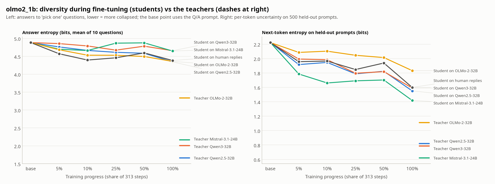
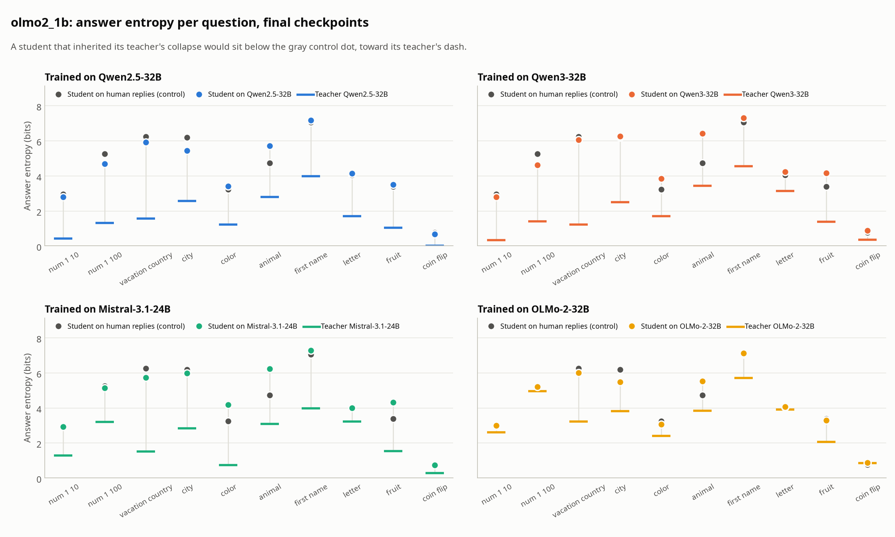
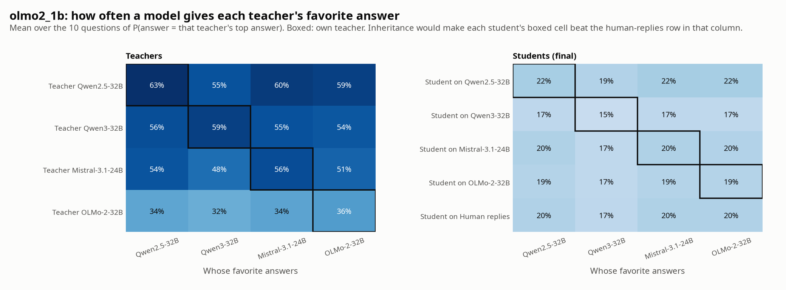
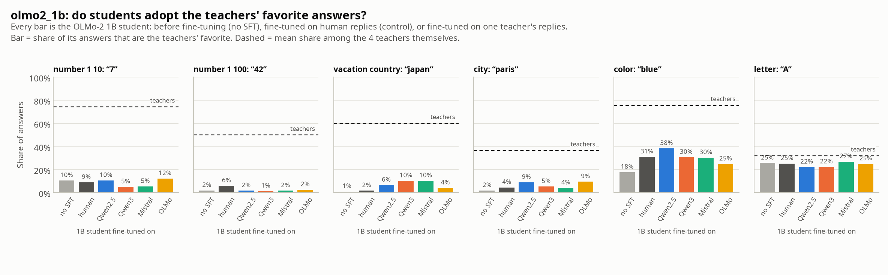
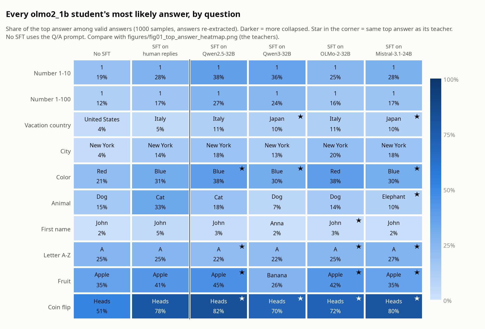

# olmo2_1b: mode collapse after SFT on teacher replies (re-scored)

Answers re-extracted with `eval/extract.py` (the first-line parser misreads sentence replies). Sample mode: 100 samples x 10 wordings per question. Entropy: plug-in, bits, at n = 200 valid answers (mean of 50 subsets). Intervals: 95% bootstrap over samples (one training seed per run, so seed-to-seed noise is not included).

## Final checkpoints

| Model | Answer entropy | 95% CI | Valid answers | Own teacher's favorite | Human control, same favorites | Next-token entropy |
| --- | --- | --- | --- | --- | --- | --- |
| Base model (Q/A prompt) | 4.88 | - | 81% | - | - | - |
| Base model (chat template) | 5.39 | - | 37% | - | - | 2.22 |
| Student on Qwen2.5-32B | 4.34 | 4.28-4.40 | 78% | 22% | 20% | 1.55 |
| Student on Qwen3-32B | 4.65 | 4.60-4.71 | 84% | 15% | 17% | 1.59 |
| Student on Mistral-3.1-24B | 4.65 | 4.59-4.70 | 77% | 20% | 20% | 1.42 |
| Student on OLMo-2-32B | 4.36 | 4.31-4.40 | 86% | 19% | 20% | 1.83 |
| Student on Human replies | 4.38 | 4.33-4.43 | 80% | - | - | 1.60 |
| Teacher Qwen2.5-32B | 1.66 | | 100% | 63% | | 0.82 |
| Teacher Qwen3-32B | 2.00 | | 100% | 59% | | 0.78 |
| Teacher Mistral-3.1-24B | 2.17 | | 97% | 56% | | 0.62 |
| Teacher OLMo-2-32B | 3.33 | | 99% | 36% | | 1.11 |

## Favorite-answer share: own teacher vs human control (final checkpoints)

| Teacher | Student on it | 95% CI | Human control | 95% CI | Difference |
| --- | --- | --- | --- | --- | --- |
| Qwen2.5-32B | 22% | 21%-23% | 20% | 20%-21% | +1.7 pts |
| Qwen3-32B | 15% | 14%-15% | 17% | 17%-18% | -2.6 pts |
| Mistral-3.1-24B | 20% | 20%-21% | 20% | 19%-21% | +0.1 pts |
| OLMo-2-32B | 19% | 19%-20% | 20% | 19%-21% | -0.7 pts |

## Favorite-answer share per question: student on teacher vs human control

Each cell: P(answer = that teacher's top answer) for the student trained on that teacher / for the human-replies control.

| Question | Qwen2.5-32B | Qwen3-32B | Mistral-3.1-24B | OLMo-2-32B |
| --- | --- | --- | --- | --- |
| `number_1_10` | “7” 10% / 9% | “7” 5% / 9% | “7” 5% / 9% | “7” 12% / 9% |
| `number_1_100` | “42” 2% / 6% | “42” 1% / 6% | “42” 2% / 6% | “42” 2% / 6% |
| `vacation_country` | “japan” 6% / 2% | “japan” 10% / 2% | “japan” 10% / 2% | “japan” 4% / 2% |
| `city` | “paris” 9% / 4% | “paris” 5% / 4% | “paris” 4% / 4% | “paris” 9% / 4% |
| `color` | “blue” 38% / 31% | “blue” 30% / 31% | “blue” 30% / 31% | “blue” 25% / 31% |
| `animal` | “elephant” 4% / 5% | “tiger” 1% / 1% | “elephant” 10% / 5% | “penguin” 1% / 0% |
| `first_name` | “liam” 0% / 0% | “emma” 0% / 1% | “alex” 1% / 1% | “john” 3% / 5% |
| `letter` | “A” 22% / 25% | “X” 2% / 1% | “A” 27% / 25% | “A” 25% / 25% |
| `fruit` | “apple” 45% / 41% | “apple” 24% / 41% | “apple” 35% / 41% | “apple” 42% / 41% |
| `coin_flip` | “heads” 82% / 78% | “heads” 70% / 78% | “heads” 80% / 78% | “heads” 72% / 78% |

## JS distance to each teacher (mean over questions; 0 = same, 1 = disjoint)

| Model | Qwen2.5-32B | Qwen3-32B | Mistral-3.1-24B | OLMo-2-32B |
| --- | --- | --- | --- | --- |
| Base model (Q/A prompt) | 0.779 | 0.751 | 0.699 | 0.591 |
| Student on Qwen2.5-32B | **0.695** | 0.664 | 0.615 | 0.529 |
| Student on Qwen3-32B | 0.741 | **0.714** | 0.669 | 0.561 |
| Student on Mistral-3.1-24B | 0.717 | 0.699 | **0.644** | 0.563 |
| Student on OLMo-2-32B | 0.706 | 0.685 | 0.630 | **0.511** |
| Student on Human replies | 0.719 | 0.690 | 0.642 | 0.531 |

## Per question: entropy (top answer, share)

| Question | Base model (Q/A prompt) | Student on Qwen2.5-32B | Student on Qwen3-32B | Student on Mistral-3.1-24B | Student on OLMo-2-32B | Student on Human replies | Teacher Qwen2.5-32B | Teacher Qwen3-32B | Teacher Mistral-3.1-24B | Teacher OLMo-2-32B |
| --- | --- | --- | --- | --- | --- | --- | --- | --- | --- | --- |
| `number_1_10` | 3.19 (1 19%) | 2.78 (1 38%) | 2.79 (1 36%) | 2.93 (1 28%) | 2.98 (1 25%) | 2.95 (1 28%) | 0.42 (7 91%) | 0.34 (7 96%) | 1.29 (7 72%) | 2.60 (7 38%) |
| `number_1_100` | 5.77 (1 12%) | 4.69 (1 27%) | 4.62 (1 24%) | 5.14 (1 17%) | 5.20 (1 16%) | 5.25 (1 17%) | 1.30 (42 64%) | 1.40 (42 76%) | 3.21 (42 38%) | 4.95 (42 20%) |
| `vacation_country` | 6.48 (united states 4%) | 5.90 (italy 11%) | 6.06 (japan 10%) | 5.73 (japan 10%) | 6.00 (italy 11%) | 6.24 (italy 5%) | 1.56 (japan 66%) | 1.23 (japan 75%) | 1.52 (japan 64%) | 3.21 (japan 34%) |
| `city` | 7.17 (new york 4%) | 5.44 (new york 18%) | 6.25 (new york 13%) | 5.96 (new york 18%) | 5.47 (new york 20%) | 6.19 (new york 14%) | 2.56 (paris 41%) | 2.48 (paris 38%) | 2.84 (paris 32%) | 3.82 (paris 34%) |
| `color` | 4.18 (red 21%) | 3.41 (blue 38%) | 3.84 (blue 30%) | 4.17 (blue 30%) | 3.05 (red 38%) | 3.23 (blue 31%) | 1.22 (blue 80%) | 1.71 (blue 73%) | 0.74 (blue 90%) | 2.41 (blue 60%) |
| `animal` | 5.53 (dog 15%) | 5.71 (cat 18%) | 6.41 (dog 7%) | 6.23 (elephant 10%) | 5.53 (dog 14%) | 4.73 (cat 33%) | 2.79 (elephant 21%) | 3.43 (tiger 26%) | 3.09 (elephant 44%) | 3.84 (penguin 22%) |
| `first_name` | 7.45 (john 2%) | 7.18 (john 3%) | 7.30 (anna 2%) | 7.27 (john 2%) | 7.12 (john 3%) | 7.05 (john 5%) | 3.98 (liam 31%) | 4.55 (emma 13%) | 3.97 (alex 18%) | 5.70 (john 13%) |
| `letter` | 4.01 (A 25%) | 4.14 (A 22%) | 4.23 (A 22%) | 4.00 (A 27%) | 4.06 (A 25%) | 4.04 (A 25%) | 1.71 (A 55%) | 3.13 (X 27%) | 3.22 (A 39%) | 3.90 (A 22%) |
| `fruit` | 4.03 (apple 35%) | 3.50 (apple 45%) | 4.15 (banana 26%) | 4.30 (apple 35%) | 3.28 (apple 42%) | 3.38 (apple 41%) | 1.03 (apple 81%) | 1.39 (apple 71%) | 1.52 (apple 67%) | 2.06 (apple 49%) |
| `coin_flip` | 1.00 (heads 51%) | 0.68 (heads 82%) | 0.87 (heads 70%) | 0.72 (heads 80%) | 0.86 (heads 72%) | 0.75 (heads 78%) | 0.01 (heads 100%) | 0.36 (heads 93%) | 0.28 (heads 95%) | 0.84 (heads 73%) |

## Over training: answer entropy / valid rate

| Run | step 16 | step 31 | step 78 | step 156 | step 313 |
| --- | --- | --- | --- | --- | --- |
| Qwen2.5-32B | 4.76 / 62% | 4.66 / 66% | 4.61 / 78% | 4.58 / 73% | 4.34 / 78% |
| Qwen3-32B | 4.85 / 63% | 4.79 / 64% | 4.67 / 83% | 4.78 / 79% | 4.65 / 84% |
| Mistral-3.1-24B | 4.70 / 69% | 4.66 / 69% | 4.87 / 77% | 4.87 / 73% | 4.65 / 77% |
| OLMo-2-32B | 4.68 / 76% | 4.53 / 78% | 4.53 / 85% | 4.49 / 81% | 4.36 / 86% |
| Human replies | 4.57 / 82% | 4.39 / 75% | 4.46 / 77% | 4.59 / 77% | 4.38 / 80% |

